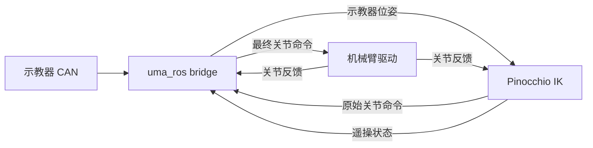

# Arm Adaptation Guide / 机械臂适配指南

[English](#english) | [中文](#中文)

Start with the checklist below. Finish each item before enabling hardware motion. Use [README](README.md) for environment setup, CAN configuration and handle operation. The Nero, Piper and Piper X integrations show the required interfaces.

从下面的检查表开始，完成一项后再进入下一项；通过全部检查后才开启真机运动。环境安装、CAN 配置和示教器操作见 [README](README.md)。Nero、Piper 和 Piper X 集成可作为接口参考。

<a id="english"></a>
## English

> [!WARNING]
> This guide and its example profiles are for integration reference only; they do not certify a new arm or configuration as safe for hardware operation. Incorrect joint mapping, limits, units, mounting, communication or control settings can cause unexpected motion, collision, injury or equipment damage. Before commanding a real arm, verify the model and feedback against the hardware, provide a working emergency stop, and test small movements at low speed in a clear workspace. You are responsible for validating the complete system for your robot and application.

### Adaptation checklist

1. Verify that the driver publishes continuous joint feedback and receives final joint targets on the ROS 2 topics in section 2.
2. Create the URDF and profile, then load the profile with URDF validation enabled.
3. Set `installation_pos` and verify the handle-to-arm axes before enabling motion.
4. Configure protected points, the workspace box and virtual walls for the actual hardware.
5. Start the driver, IK and bridge from the same profile with unique node and interface names.
6. Run data-path checks without arm motion, then test low-speed motion in a clear workspace.

<details>
<summary><strong>1. Control flow and responsibilities</strong></summary>


`side` is `left` or `right`; a single arm can use either route. The profile's `installation_pos` describes physical mounting independently of that route.

| Layer | Responsibility |
| --- | --- |
| Your driver | Vendor SDK, CAN/serial/EtherCAT, enable, speed, emergency stop, hardware limits and unit conversion |
| IK | URDF kinematics, live feedback, target mapping, joint solving and configured safety constraints |
| Handle bridge | Handle data, enable button, homing and final command forwarding |
| Profile | Robot model, home state, installation, IK and safety settings |

Keep vendor communication in your own driver package. Before reusing IK, check that the bridge's joint and gripper conventions match your robot. Complete the driver, profile and bridge conventions for the new arm.

**Done when:** the launch starts the driver, IK and bridge, and all three use the same joint names and topic conventions.

</details>

<details>
<summary><strong>2. ROS interfaces and joint conventions</strong></summary>

Examples use the left route; replace `left` with `right` for the right route.

| Direction | Topic | Type | Purpose |
| --- | --- | --- | --- |
| Driver → IK / bridge | `/feedback/joint_states_left` | `sensor_msgs/msg/JointState` | Required continuous joint feedback |
| Bridge → driver | `/control/move_js_left` | `sensor_msgs/msg/JointState` | Required final joint targets |
| IK → bridge | `/control/joint_states_left_raw` | `sensor_msgs/msg/JointState` | Internal IK output; bridge forwards final commands to the driver |
| Bridge → IK | `/left_handle_pose` | `geometry_msgs/msg/PoseStamped` | Handle end pose |
| IK → bridge | `/left_teleop_enable` | `std_msgs/msg/Bool` | Current teleoperation state |

`/left_teleop_trigger` is a `std_srvs/srv/Trigger` service that toggles teleoperation. TCP pose and driver status are optional extension topics.

### JointState

- `name` and `position` must have equal lengths, unique names and finite positions. Arm joint positions use radians.
- Profiles derive names from URDF revolute joints. Match driver names, directions and zeros to the URDF; do not rely on a custom YAML `joints` block to rename them.
- IK reads feedback by name and outputs commands in URDF arm order. The driver can map those names to vendor channels.
- Homing interpolates by array index. Keep feedback order stable and aligned with `arm_home_state`: the first `nq` entries are arm joints in URDF order, followed by any extra channels.
- Publish feedback continuously and implement command timeout and hardware stop handling in the driver. Stopping publications does not cancel a controller's previous motion command.

A six-joint feedback/home channel layout can be:

```text
name:     [joint1, joint2, joint3, joint4, joint5, joint6]
position: [q1,     q2,     q3,     q4,     q5,     q6    ]  # rad
```

**Done when:** `/feedback/joint_states_left` publishes continuously, `profile.feedback_to_q()` parses every sample, and the command topic receives joint names and radian values that the driver accepts.

</details>

<details>
<summary><strong>3. URDF and a minimal profile</strong></summary>

### URDF requirements

Place the URDF and meshes in your description package, for example `my_robot_description/urdf/my_robot.urdf`. The current integration expects a fixed base and single-DoF revolute arm joints. Continuous joints, joints with multiple DoFs and mobile bases need additional adaptation.

1. Ensure `base_frame` exists and URDF axes, zeros and limits match the hardware.
2. Supply an existing `ee_frame`, or create a tool frame with `ee_offset`.
3. Use `locked_joints` to exclude movable non-arm joints.
4. Install and source the ROS packages referenced by `package://`, and check that mesh paths resolve.

### Minimal configuration

This template is for an **upright six-joint arm without gripper channels**. Replace the model path, home angles and workspace limits, then save it as `my_robot_profile.yaml`. Values below illustrate the fields.

```yaml
robot:
  name: my_robot
  urdf_path: package://my_robot_description/urdf/my_robot.urdf
  base_frame: base_link
  ee_frame: tool0
  locked_joints: []
  installation_pos: horizontal
  effector_type: none
  arm_home_state:
    default: [0.0, 0.0, 0.0, 0.0, 0.0, 0.0]

ik:
  enable_hard_delta_q_constraint: true
  max_delta_q_rad: 0.1
  enable_psi_constraint: false
  enable_elbow_side_penalty: false
  singularity_weight: 0.02

handle:
  zoom_factor: 1.0

safety:
  virtual_walls: []
  workspace:
    frame: base_link
    type: box
    min: [-0.5, -0.5, 0.0]
    max: [0.5, 0.5, 0.8]
    margin: 0.02
    protected_frames: [tool0]
```

`ee_frame: tool0` requires that frame in the URDF. Otherwise remove `ee_frame` and use:

```yaml
robot:
  ee_offset:
    parent_joint: joint6
    xyz: [0.0, 0.0, 0.10]  # Relative to joint origin, m
    rpy: [0.0, 0.0, 0.0]   # rad
```

`ee_offset` creates a tool frame named `ee`; replace `tool0` with `ee` in the safety settings. Choose one tool definition. These `xyz/rpy` values describe the tool offset in the model, not installation compensation.

`effector_type` selects both enablement and type: `none`, `agx_gripper`, or `revo2`. Piper/Nero demos pass it to their example driver. Your driver must read this field or implement an equivalent mapping.

### Per-side end effectors and workspaces

Use `robot.effector_type: {left: agx_gripper, right: none}` for different end effectors. Home keys name routes (`left/right/default`), not models. Both arms in one profile share the URDF and joint layout; use separate profiles for different models.

```yaml
safety:
  workspace:
    left:
      frame: base_link
      type: box
      min: [-0.5, -0.4, 0.0]
      max: [0.5, 0.2, 0.8]
      margin: 0.02
      protected_frames: [ee]
    right:
      frame: base_link
      type: box
      min: [-0.5, -0.2, 0.0]
      max: [0.5, 0.4, 0.8]
      margin: 0.02
      protected_frames: [ee]
```

Replace these bounds with limits validated for your robot. Keep `ee` for the tool tip, or select another protected frame. Each side is an independent Box. Provide a `default` Box for fallback when both sides share the same limits; a missing side then raises an error. `{}` explicitly disables that side's workspace (virtual walls remain active). A shared Box applies to both arms. `side` names the route; each Box uses its declared frame.

Edit with `ros2 launch arm_safety_monitor safety_monitor.launch.py profile_name:=nero_profile.yaml side:=left`; use `side:=right` for the other arm. Saving or deleting a Box affects only the selected side. Editing a shared/default Box creates a side override. Save and close before opening another editor on the same file; virtual walls are shared.

### Home state

`arm_home_state` supplies bridge homing commands and the side-mount FK direction reference. Each teleoperation session starts from live joint feedback; enabling does not command the configured home pose.

Use `default` for one arm, or provide complete channels for each side. Do not combine two arms into one list:

```yaml
robot:
  arm_home_state:
    left:  [0.0, 0.0, 0.0, 0.0, 0.0, 0.0]
    right: [0.0, 0.0, 0.0, 0.0, 0.0, 0.0]
```

IK selects the `side` entry, falling back to `default`. Piper and Nero bridge wrappers use the same side/default selection. Piper's example has 9 channels (6 arm + 3 end-effector); Nero has 10 per side (7 arm + 3 end-effector). These lengths describe the example driver layouts; set the list length from the actual feedback channels.

**Done when:** `load_profile()` passes URDF validation, all frames and locked joints resolve, and `arm_home_state` matches the real feedback channel count.

</details>

<details>
<summary><strong>4. Upright and side mounting</strong></summary>

`robot.installation_pos` accepts `horizontal` (upright), `left`, or `right`. These definitions apply to Nero, Piper and other arms.

### Upright: align at each enable

`horizontal` uses `base_frame` +X as forward and +Z as up, independently of the current TCP orientation or `arm_home_state` rotation. Confirm the model axes match the intended forward direction. If the URDF root differs from `base_frame`, horizontal mode converts the live FK anchor into `base_frame`.

1. Before starting the bridge, place the handle level in its prescribed zero pose, with its forward axis along handle `world +X`. Reset the IMU in this pose so the heading reference is correct.
2. Before each double-click to enable, hold the handle roughly level and point it in your intended forward direction. That direction's horizontal projection maps to arm +X, horizontal left to +Y, and `world +Z` to arm +Z. The enable step uses this heading to establish the yaw mapping.
3. During the session the mapping stays fixed. Rotating the handle changes target orientation; the translation axes remain fixed. Disable and re-enable to select another heading, anchored at the arm's current pose.

Enabling is rejected when the handle points within 15° of vertical, or when handle pose/joint feedback is invalid or stale. Level the handle and retry. Vertical rotation is allowed after enabling. The bridge relies on its calibrated `world +Z` and assumes the handle base remains stationary. Keep the base stable and reset the IMU only while teleoperation is inactive.

Translation and rotation share the mapping `C` frozen at enable. `a0` and `h0` denote the initial arm and handle poses:

```text
p_target = p_a0 + C (p_h - p_h0)
R_target = C (R_h R_h0^T) C^T R_a0
```

### Side mounting: existing mapping

| Installation | Handle `world +x` | Handle `world +y` | Handle `world +z` |
| --- | --- | --- | --- |
| `left` | `base +y` | `base +z` | `base +x` |
| `right` | `base -y` | `base -z` | `base +x` |

`base` is the profile's `base_frame`. `left/right` retain the v0.1.0 Nero home-FK directions and the existing orientation-increment path. This legacy path requires the URDF root to coincide with `base_frame`, as in the bundled models.

### Configuration and driver

An upright single arm can keep the right CAN/ROS route:

```yaml
robot:
  installation_pos: horizontal
```

Keep Piper's installation setting at `horizontal`. Use `right` for a right-side physical mounting. Configure sides separately when their mounting differs:

```yaml
robot:
  installation_pos:
    left: left
    right: horizontal
```

Mappings support a `default` fallback. A missing field defaults to `horizontal`; invalid values, empty mappings, or a missing side with no default are rejected. When migrating a side-mounted custom profile from v0.1.0, set the installation explicitly.

Drivers that support installation settings must use the same value. The Piper demo sends it for controller gravity compensation. The current Nero driver has no installation-setting interface; teleoperation mapping still applies. For your own driver, configure installation, payload and gravity compensation through its hardware interface.

**Done when:** before enabling teleoperation, the handle's level forward, left and `world +Z` directions map to the expected arm +X, +Y and +Z directions; re-enabling after disable establishes the mapping again.

</details>

<details>
<summary><strong>5. IK, speed and safety settings</strong></summary>

| Setting | Purpose / convention |
| --- | --- |
| `ik.max_delta_q_rad` | Maximum per-step joint change; scalar or `nq` values, example 0.1 rad |
| `ik.enable_hard_delta_q_constraint` | Enforce that step limit as a hard constraint |
| `ik.enable_psi_constraint` | Elbow configuration retention; requires shoulder/elbow/wrist reference frames |
| `ik.enable_joint_reference_penalty` | Soft penalty for departing from the previous IK joint state |
| `ik.enable_elbow_side_penalty` | Elbow side penalty; also requires shoulder/elbow/wrist frames |
| `ik.singularity_weight` | Singularity penalty weight, example 0.02 |
| `handle.zoom_factor` | Handle translation scale; start at 1.0 |
| `feedback_timeout_sec` | Teleop launch parameter, default 1.0 s. Joint feedback timeout ends the session; enabling upright mode requires a handle pose no older than this interval. |

Configure IK step limits and hardware speed separately. High-level demos currently **do not read** `robot.speed_percent` from the profile. To set speed with the example driver, start it in a separate terminal:

```bash
ros2 launch agx_arm_ctrl start_single_agx_arm.launch.py \
  arm_type:=piper can_port:=right_arm topics_end:=_right \
  installation_pos:=horizontal speed_percent:=30
```

Then start IK and bridge with `demo_piper.launch.py start_arm:=false`; add `arm_type:=piper_x` for Piper X. The driver's `speed_percent` ranges from 0 to 100 and defaults to 100. For your own driver, use the vendor's speed interface.

### Protected points, workspace and virtual walls

`protected_frames` constrains frame origins, not entire links. Select tool, elbow and wrist points separately; use `safety_frames` for auxiliary frames:

```yaml
safety:
  safety_frames:
    elbow_point: joint3
    wrist_point:
      parent_joint: joint5
      xyz: [0.0, 0.0, 0.05]
      rpy: [0.0, 0.0, 0.0]
  virtual_walls:
    - name: table
      type: plane
      frame: base_link
      point: [0.0, 0.0, 0.0]
      normal: [0.0, 0.0, 1.0]
      keep_side: positive
      margin: 0.02
      protected_frames: [tool0, wrist_point]
```

Merge this into the existing `safety` block, retaining the desired workspace; do not duplicate top-level YAML keys. This example keeps points on the normal side of the plane, at least 0.02 m away. `keep_side: negative` selects the other side. `normal` must be nonzero and `margin` nonnegative.

Each box `min` must be below `max`, with reachable space after accounting for `margin`. Virtual walls are infinite planes; their RViz display width only affects the visualization. `robot.collision_pairs` controls post-solve self-collision checks. Opti hard constraints come from the IK settings. Verify geometry indices for your model.

Edit a custom profile offline:

```bash
UMA_PROFILE_DIR=/absolute/path/to/config \
  ros2 launch arm_safety_monitor safety_monitor.launch.py \
  profile_name:=my_robot_profile.yaml
```

Drag Box/Plane markers in RViz, right-click to save, then restart the teleop node to load changes. New editor objects default to `protected_frames: [ee]`; for this guide's template, change that to the actual `tool0` frame after saving. See [README](README.md) for the full safety editor workflow.

**Done when:** the profile validates, each protected point triggers the constraint near the corresponding boundary, and a restart loads the saved configuration.

</details>

<details>
<summary><strong>6. Launch integration: driver + IK + bridge</strong></summary>

Load Conda, ROS and the workspace as described in README. Your launch must connect all three components and supply IK and bridge with the same profile's home and scale settings.

This complete launch template uses the six-joint, no-gripper profile from section 3 and handle geometry from the current wrapper. Replace the driver package/launch names and install it as `my_robot_bringup/launch/teleop.launch.py`:

```python
from agx_arm_ctrl.robot_profile import format_arm_home_state, load_profile
from launch import LaunchDescription
from launch.actions import DeclareLaunchArgument, IncludeLaunchDescription, OpaqueFunction
from launch.launch_description_sources import PythonLaunchDescriptionSource
from launch.substitutions import LaunchConfiguration, PathJoinSubstitution
from launch_ros.substitutions import FindPackageShare


def include_launch(package, filename, arguments):
    return IncludeLaunchDescription(
        PythonLaunchDescriptionSource(
            PathJoinSubstitution([FindPackageShare(package), "launch", filename])
        ),
        launch_arguments=arguments.items(),
    )


def build(context):
    side = LaunchConfiguration("side").perform(context)
    path = LaunchConfiguration("profile_path").perform(context)
    profile = load_profile(path, validate_robot=False)
    bridge_args = {
        "port_name": LaunchConfiguration("port_name"),
        "node_name": f"uma_{side[0]}",
        "uma_pose_topic": f"/{side}_handle_pose",
        "remote_joint_topic_in": f"/control/joint_states_{side}_raw",
        "remote_joint_topic_out": f"/control/move_js_{side}",
        "remote_joint_single_topic": f"/feedback/joint_states_{side}",
        "teleop_enable_topic": f"/{side}_teleop_enable",
        "remote_service_name": f"{side}_teleop_trigger",
        "arm_home_state": format_arm_home_state(profile, side),
        "angle_reverse": str(side == "right").lower(),
        "publish_sim_joint": "false",
        "is_nero": "false",
        "use_piper_mode": "false",
        "use_pose_dt_zoom": "true",
        "use_trigger_pose": "true",
        "zoom_factor": str(profile.handle.get("zoom_factor", 1.0)),
        "gripper_length": "0.0",
        "handle_seg0": "[0.0, 0.0, 0.0534, 0.0, 0.0, 0.0]",
        "handle_seg1": "[0.0, 0.0, 0.0, 1.5707963, 0.0, 3.1415926]",
        "handle_seg2": "[0.220, 0.0, 0.0, 0.0, 0.0, -1.5707963]",
        "handle_seg3": "[-0.04804, -0.19115, 0.05487, 1.5707963, 0.0, 0.0]",
    }
    return [
        include_launch("my_robot_driver", "my_robot_driver.launch.py", {
            "side": side,
            "installation_pos": profile.installation_pos_for(side),
        }),
        include_launch("agx_arm_ctrl", "teleop_single_arm.launch.py", {
            "side": side,
            "node_name": f"teleop_{side}_arm_node",
            "profile_path": path,
        }),
        include_launch("uma_bringup", "run_single_node.launch.py", bridge_args),
    ]


def generate_launch_description():
    return LaunchDescription([
        DeclareLaunchArgument("profile_path"),
        DeclareLaunchArgument("side", default_value="left", choices=["left", "right"]),
        DeclareLaunchArgument("port_name", default_value="left_uma"),
        OpaqueFunction(function=build),
    ])
```

The template assumes your driver launch accepts `side` and `installation_pos` and configures ROS interfaces and hardware accordingly. Adapt those names to your driver. Configure its CAN/serial address there; `port_name` refers only to the teaching handle's CAN interface. If the hardware has no installation setting, use the driver's supported configuration; IK profile mapping applies independently.

```bash
ros2 launch my_robot_bringup teleop.launch.py \
  profile_path:=/absolute/path/my_robot_profile.yaml \
  side:=left port_name:=left_uma
```

For the right route, use `side:=right port_name:=right_uma`. Launch one instance per route for dual arms, with unique node names and driver interfaces. Do not start both the high-level demo's example driver and your own driver.

**Done when:** one launch starts the complete chain, every node has a unique name, and IK and bridge read the home position and zoom factor from the same profile.

</details>

<details>
<summary><strong>7. Grippers and extra channels</strong></summary>

IK outputs only URDF arm joints `q`. The current bridge retains some model conventions; check seven-axis arms and extra end-effector channels separately before reusing the six-joint template.

| Existing path | Behavior | Check for a new arm |
| --- | --- | --- |
| `agx_gripper` | Keeps the arm array intact and publishes a separate gripper JointState topic | Gripper subscription, units and control fields |
| `revo2` | Initializes the hand driver | Send finger commands through the hand-specific interface |
| Homing | Interpolates complete `arm_home_state` against feedback | Extra channel count, order, units and home meaning |

Six-axis IK publishes URDF arm joints only. With `effector_type: agx_gripper`, the Piper/Nero bridge publishes gripper commands separately. Other drivers must implement the corresponding subscription. Set width limits in metres, with minimum no greater than maximum, within the hardware stroke.

Piper/Nero wrappers contain their handle geometry, modes and home selection. Check [bridge_launch.py](uma_bringup/uma_bringup/bridge_launch.py) and bridge output handling before reuse. Check the end-effector protocol for each model.

**Done when:** arm commands contain no gripper values, and grippers, dexterous hands and home-only channels each have explicit command and feedback paths.

</details>

<details>
<summary><strong>8. Acceptance checks and troubleshooting</strong></summary>

Validate the model, inspect data, then test slow hardware motion. Commands below use the left route.

**Load the model:** substitute your profile path and run in the prepared `uma` environment:

```bash
python - <<'PY'
from agx_arm_ctrl.robot_profile import load_profile
profile = load_profile('/absolute/path/my_robot_profile.yaml')
print('nq:', profile.nq)
print('joints:', [joint.urdf_name for joint in profile.joints])
print('installation:', profile.installation_pos_for('left'))
PY
```

**Inspect the data path:** `--once` waits for one message. Command topics may remain quiet while teleoperation is disabled.

```bash
ros2 topic hz /left_handle_pose
ros2 topic hz /feedback/joint_states_left
ros2 topic echo /feedback/joint_states_left --once
ros2 topic echo /left_teleop_enable --once
ros2 topic echo /control/joint_states_left_raw --once
ros2 topic echo /control/move_js_left --once
```

**Hardware acceptance:**

1. Before enabling motion output, verify feedback names, units, order, `nq` and target reachability.
2. Initialize and enable as in section 4. Test small forward/left/up movements and rotations about all three axes; check for no initial jump. For upright arms, also test re-enabling at another heading, translating after rotating the handle, and rejection of a vertical start. For side mounting, verify the section 4 table. Upright Nero and Piper use the same rule.
3. Configure low hardware speed before enabling motion. Check homing and gripper behavior separately; homing commands motion.
4. Verify feedback loss ends the session and re-enabling after recovery establishes a new anchor. Check the driver's own timeout and stopping behavior. Test teaching/drag mode separately where gravity settings apply.
5. Check protected points near Box/Plane boundaries. Save and restart to confirm the intended safety configuration is loaded.

| Symptom | Check first |
| --- | --- |
| Profile fails to load | URDF path, existing frames, `locked_joints`, home list |
| `nq` or feedback mismatch | Non-arm joints, joint names, feedback length/order |
| Upright x/z still swapped | Loaded profile, `installation_pos: horizontal`, current install space |
| Wrong forward direction / request to level handle | Correct initialization zero; disable, level, point forward and re-enable |
| IK infeasible | Limits, box margins, wall normals/kept side, protected points, `wall_dist` logs |
| Stops immediately after enable | Continuous fresh feedback and `feedback_timeout_sec` |
| Raw commands but no final commands | Bridge subscriptions, enable state, timeout |
| Final commands but no motion | Driver subscription, enable, joint mapping, vendor API/hardware state |
| YAML speed change has no effect | Demo does not read `speed_percent`; use driver parameters |
| Seven-axis final joint behaves incorrectly | Check whether bridge handling treats joint seven as gripper data |

**Done when:** every data-path check passes, low-speed motion has no jump or axis error, and feedback loss, homing, gripper behavior and safety boundaries have been verified on the hardware.

</details>

<details>
<summary><strong>9. Piper / Piper X / Nero reference launches</strong></summary>

These demos start the example driver, IK and bridge by default. Choose one:

```bash
# Piper: right route; upright mounting set in piper_profile.yaml
ros2 launch uma_bringup demo_piper.launch.py

# Piper: left route with explicit left CAN ports
ros2 launch uma_bringup demo_piper.launch.py \
  side:=left arm_port:=left_arm port_name:=left_uma backend:=python

# Piper X: upright single arm
ros2 launch uma_bringup demo_piper.launch.py arm_type:=piper_x

# Piper X: upright dual arm
ros2 launch uma_bringup demo_dual_piper_x.launch.py
ros2 launch uma_bringup demo_dual_piper_x.launch.py backend:=python

# Nero: dual arm
ros2 launch uma_bringup demo_nero_bringup.launch.py
ros2 launch uma_bringup demo_nero_bringup.launch.py backend:=python

# Compatible driver already running: start only Piper IK and bridge
ros2 launch uma_bringup demo_piper.launch.py start_arm:=false \
  profile_path:=$PWD/src/UMA_Control/uma_bringup/config/piper_profile.yaml
```

`start_arm:=false` starts the driver separately; the driver must satisfy section 2. The bridge supplies handle poses, button handling and final command forwarding.

**Done when:** the reference demo starts and handle poses, IK output and final joint commands flow in the directions defined in section 2.

</details>

<a id="中文"></a>
## 中文

> [!WARNING]
> 本指南及示例 profile 仅供适配参考，不表示新机械臂或配置已通过真机安全验证。关节映射、限位、单位、安装方向、通信或控制参数错误，可能导致意外运动、碰撞、人身伤害或设备损坏。向真机发送运动指令前，请对照硬件核实模型与反馈，确保急停可用，并在空旷环境中以低速、小幅度测试。适配者须自行验证具体机械臂及应用的完整系统。

### 适配检查表

1. 确认驱动按第 2 节要求持续发布关节反馈，并订阅最终关节目标。
2. 准备 URDF 和 profile，并启用 URDF 校验加载 profile。
3. 设置 `installation_pos`，开启运动前核对示教器与机械臂的轴向。
4. 按实际硬件配置保护点、工作空间 Box 和虚拟墙。
5. 使用同一份 profile 启动驱动、IK 和 bridge，并确保节点名与接口名唯一。
6. 先在不接入机械臂运动的情况下检查数据链路，再在空旷环境中测试低速运动。

<details>
<summary><strong>1. 接入链路与职责</strong></summary>



`side` 取 `left` 或 `right`，单臂使用其中一路。profile 的 `installation_pos` 描述机械臂实际安装方向，可以与通信路由独立选择。

| 层 | 负责内容 |
| --- | --- |
| 用户驱动 | 厂商 SDK、CAN/串口/EtherCAT、使能、速度、急停、硬件限位及关节单位转换 |
| IK | URDF 运动学、实时反馈、末端目标映射、关节求解及配置的安全约束 |
| 示教器 bridge | 示教器数据、按键开关、回零命令及最终关节命令转发 |
| Profile | 机械臂模型、回零状态、安装方向、IK 与安全参数 |

厂商通信代码放在自己的驱动包。复用 IK 前，确认 bridge 的关节顺序、方向、零位和夹爪约定与机械臂一致。完整适配还包括驱动、profile 和 bridge 约定。

**完成条件：** launch 能同时找到驱动、IK 和 bridge，且三者使用同一套关节命名与话题约定。

</details>

<details>
<summary><strong>2. ROS 接口与关节约定</strong></summary>

以左路为例；右路将 `left` 替换为 `right`。

| 方向 | Topic | 类型 | 用途 |
| --- | --- | --- | --- |
| 驱动 → IK / bridge | `/feedback/joint_states_left` | `sensor_msgs/msg/JointState` | 必需，持续发布关节反馈 |
| bridge → 驱动 | `/control/move_js_left` | `sensor_msgs/msg/JointState` | 必需，执行最终关节目标 |
| IK → bridge | `/control/joint_states_left_raw` | `sensor_msgs/msg/JointState` | 内部 IK 输出；bridge 将最终关节命令发给驱动 |
| bridge → IK | `/left_handle_pose` | `geometry_msgs/msg/PoseStamped` | 示教器末端位姿 |
| IK → bridge | `/left_teleop_enable` | `std_msgs/msg/Bool` | 当前遥操开关状态 |

`/left_teleop_trigger` 为 `std_srvs/srv/Trigger` 服务，每次调用切换一次遥操。TCP 位姿和驱动状态是可选扩展反馈。

### JointState

- `name` 与 `position` 等长，名称不重复，位置都是有限数值；臂关节使用 rad。
- profile 从 URDF 的 revolute 关节推导关节名。驱动必须匹配这些名称、方向和零位，YAML 中自定义的 `joints` 不会重命名关节。
- IK 按名称读取反馈，按 URDF 臂关节顺序发布命令。驱动可以将这些名称映射到厂商通道。
- bridge 回零时按数组位置插值。反馈顺序必须稳定，并与 `arm_home_state` 一致：前 `nq` 项是按 URDF 顺序排列的臂关节，额外通道放在后面。
- 驱动持续发布反馈，并自行实现命令超时和硬件停止。停止发布命令不会撤销厂商控制器此前收到的运动指令。

例如，一个六关节驱动的反馈和回零通道可约定为：

```text
name:     [joint1, joint2, joint3, joint4, joint5, joint6]
position: [q1,     q2,     q3,     q4,     q5,     q6    ]  # rad
```

**完成条件：** `/feedback/joint_states_left` 能稳定发布，`profile.feedback_to_q()` 能解析每个样本；命令话题能收到驱动可识别的关节名称和 rad 值。

</details>

<details>
<summary><strong>3. URDF 和最小 profile</strong></summary>

### URDF 要求

将 URDF 和 mesh 放在自己的 description 包中，例如 `my_robot_description/urdf/my_robot.urdf`。当前链路要求固定基座和单自由度 revolute 臂关节。continuous 关节、多自由度关节或移动基座需要额外适配。

逐项核对：

1. `base_frame` 存在，URDF 的轴向、零位和限位与实际硬件一致。
2. 末端已有 `ee_frame`，或者通过 `ee_offset` 创建工具 frame。
3. 通过 `locked_joints` 排除模型中的非臂可动关节；不要只截断 IK 输出数组。
4. `package://` 资源所在的 ROS 包已经安装并加载，mesh 路径可解析。

### 最小配置

下面的模板适用于**六关节、无夹爪通道、正装**机械臂。替换模型路径、回零角度和空间边界后保存为 `my_robot_profile.yaml`；示例数值只用于说明字段。

```yaml
robot:
  name: my_robot
  urdf_path: package://my_robot_description/urdf/my_robot.urdf
  base_frame: base_link
  ee_frame: tool0
  locked_joints: []
  installation_pos: horizontal
  effector_type: none
  arm_home_state:
    default: [0.0, 0.0, 0.0, 0.0, 0.0, 0.0]

ik:
  enable_hard_delta_q_constraint: true
  max_delta_q_rad: 0.1
  enable_psi_constraint: false
  enable_elbow_side_penalty: false
  singularity_weight: 0.02

handle:
  zoom_factor: 1.0

safety:
  virtual_walls: []
  workspace:
    frame: base_link
    type: box
    min: [-0.5, -0.5, 0.0]
    max: [0.5, 0.5, 0.8]
    margin: 0.02
    protected_frames: [tool0]
```

`ee_frame: tool0` 要求 URDF 中存在该 frame。没有时可以删除 `ee_frame`，改用：

```yaml
robot:
  ee_offset:
    parent_joint: joint6
    xyz: [0.0, 0.0, 0.10]  # 相对关节原点，m
    rpy: [0.0, 0.0, 0.0]   # rad
```

`ee_offset` 会在运行时创建名为 `ee` 的工具 frame，此时将安全配置中的 `tool0` 改为 `ee`。`ee_frame` 和 `ee_offset` 必须提供其中一个。`xyz/rpy` 表示工具相对父关节的偏移，不用于补偿安装方向。

`effector_type` 同时控制末端执行器开关和类型：`none` 关闭，`agx_gripper` 使用夹爪，`revo2` 使用灵巧手。Piper 和 Nero demo 会把该值传给示例驱动；自有驱动需要读取该字段或做等价映射。

### 分侧末端执行器与工作空间

末端类型可以按侧配置，例如 `robot.effector_type: {left: agx_gripper, right: none}`。回零键使用通信路由 `left/right/default`。同一 profile 的两侧共用 URDF 和关节结构；不同机型使用独立 profile。

```yaml
safety:
  workspace:
    left:
      frame: base_link
      type: box
      min: [-0.5, -0.4, 0.0]
      max: [0.5, 0.2, 0.8]
      margin: 0.02
      protected_frames: [ee]
    right:
      frame: base_link
      type: box
      min: [-0.5, -0.2, 0.0]
      max: [0.5, 0.4, 0.8]
      margin: 0.02
      protected_frames: [ee]
```

以上边界需要按硬件标定。`ee` 可以保护工具尖端，也可以替换为其他保护点。每侧 Box 独立完整。两侧边界相同时，使用 `default` 作为回退；缺少当前侧就报错。`{}` 显式关闭该侧 workspace，虚拟墙仍然生效。共享 Box 会同时用于两侧。`side` 只表示通信路由；每个 Box 使用自己声明的 frame。

分侧 workspace 必须指定 `side`。编辑左侧可运行 `ros2 launch arm_safety_monitor safety_monitor.launch.py profile_name:=nero_profile.yaml side:=left`，编辑右侧改为 `side:=right`。保存或删除只影响所选侧；编辑共享 Box 或 `default` Box 时会生成该侧的覆盖项。保存并关闭当前编辑器后，再打开另一侧。虚拟墙由两侧共享。

### 回零状态

`arm_home_state` 用于 bridge 回零命令和侧装模式的方向 FK 参考。每次遥操都以开启时的实时关节反馈为起点；profile 的回零位置用于回零命令和方向参考。

单臂使用 `default`。双臂分别为每一侧填写完整通道：

```yaml
robot:
  arm_home_state:
    left:  [0.0, 0.0, 0.0, 0.0, 0.0, 0.0]
    right: [0.0, 0.0, 0.0, 0.0, 0.0, 0.0]
```

IK 按 `side` 取值，缺少对应项时回退到 `default`。Piper 和 Nero bridge wrapper 使用相同规则。Piper 示例为 9 项（6 个臂关节 + 3 个末端通道），Nero 每侧为 10 项（7 个臂关节 + 3 个末端通道）。这些长度对应示例驱动布局；适配时应让回零列表长度与实际反馈通道数一致。

**完成条件：** `load_profile()` 通过 URDF 校验，所有 frame 和锁定关节都能解析，`arm_home_state` 的长度与真实反馈一致。

</details>

<details>
<summary><strong>4. 正装与侧装</strong></summary>

`robot.installation_pos` 支持 `horizontal`（正装）、`left`（左侧装）和 `right`（右侧装）。Nero、Piper 和其他机械臂都使用这组定义。

### 正装：每次开启时对齐

`horizontal` 以 `base_frame` 的 +X 为前方、+Z 为上方，与当前 TCP 朝向和 `arm_home_state` 的旋转无关。请确认模型的坐标轴符合机械臂操作前方。URDF 根坐标与 `base_frame` 不重合时，正装模式会先把实时 FK 起点转换到 `base_frame`。

1. 启动 bridge 前，将示教器按规定的零位放平，使前向与 `world +X` 一致。请在这个姿态重置 IMU，使航向参考正确。
2. 每次双击开启前，将示教器大致放平，并指向希望的操作前方。该方向的水平投影映射到机械臂 +X，水平左方映射到 +Y，`world +Z` 映射到机械臂 +Z。开启步骤会用这个朝向建立偏航映射。
3. 开启后映射保持固定。转动手柄改变目标姿态，平移轴保持固定。关闭后重新开启，系统会重新取得朝向，并以机械臂当前位姿作为起点。

手柄前向与竖直方向的夹角小于或等于 15° 时，开启请求会被拒绝。将手柄放平后重试。手柄位姿和关节反馈必须有效且新鲜。开启后可以转到竖直姿态。这里的“竖直”以 bridge 已标定的 `world +Z` 为准；系统不测量重力，也不补偿示教器底座移动。会话中保持底座稳定，不要重置 IMU。

平移和旋转共用开启时固定的映射 `C`，起点分别为机械臂 `a0` 和手柄 `h0`：

```text
p_target = p_a0 + C (p_h - p_h0)
R_target = C (R_h R_h0^T) C^T R_a0
```

### 侧装：保留原有映射

| 安装方向 | 示教器 `world +x` | 示教器 `world +y` | 示教器 `world +z` |
| --- | --- | --- | --- |
| `left` | `base +y` | `base +z` | `base +x` |
| `right` | `base -y` | `base -z` | `base +x` |

表中的 `base` 指 profile 的 `base_frame`。`left/right` 保留 v0.1.0 Nero 双臂 home FK 对应的侧装方向，姿态增量沿用原有路径。该路径要求 URDF 根坐标与 `base_frame` 重合，仓库示例满足这个条件。

### 配置与驱动

正装单臂使用右路 CAN 和 ROS 接口时，只需设置：

```yaml
robot:
  installation_pos: horizontal
```

Piper 的安装参数不需要改成 `right` 来补偿遥操方向。两侧安装方向不同时，按路配置：

```yaml
robot:
  installation_pos:
    left: left
    right: horizontal
```

映射支持 `default`，用于当前路由没有单独配置时回退。字段缺失时默认使用 `horizontal`。非法值、空映射，以及当前路由既没有配置也没有 `default` 的情况都会报错。从 v0.1.0 迁移侧装自定义 profile 时，需要显式填写安装方向。

硬件驱动支持安装配置时，必须使用同一个值。Piper demo 会自动下发该值，供控制器配置重力补偿。当前 Nero 驱动保留自身设置，遥操平移映射仍然生效。自有驱动需要自行下发安装、负载和重力补偿参数。

**完成条件：** 开启遥操前，示教器水平前向、左向和 `world +Z` 分别对应机械臂预期的 +X、+Y、+Z；关闭后重新开启也能重新建立映射。

</details>

<details>
<summary><strong>5. IK、速度和安全参数</strong></summary>

| 配置 | 用途 / 约定 |
| --- | --- |
| `ik.max_delta_q_rad` | 每步最大关节变化，标量或 `nq` 项列表；示例为 0.1 rad |
| `ik.enable_hard_delta_q_constraint` | 是否将单步变化作为硬约束 |
| `ik.enable_psi_constraint` | 肘部构型保持；需配置肩、肘、腕参考 frame |
| `ik.enable_joint_reference_penalty` | 对偏离上一轮 IK 关节状态施加软惩罚 |
| `ik.enable_elbow_side_penalty` | 肘部侧向惩罚；同样需要肩、肘、腕 frame |
| `ik.singularity_weight` | 奇异性惩罚权重，示例为 0.02 |
| `handle.zoom_factor` | 手柄映射缩放，先从 1.0 开始调试 |
| `feedback_timeout_sec` | teleop launch 参数，默认 1.0 s。关节反馈超时后停止会话；正装模式开启时要求手柄位姿不超过该时限。 |

IK 单步角度限制和硬件速度分别配置。当前示例启动入口 **不读取** profile 中的 `robot.speed_percent`，只修改 YAML 不会改变速度。使用仓库示例驱动时，在独立终端启动驱动并传入速度：

```bash
ros2 launch agx_arm_ctrl start_single_agx_arm.launch.py \
  arm_type:=piper can_port:=right_arm topics_end:=_right \
  installation_pos:=horizontal speed_percent:=30
```

然后用 `demo_piper.launch.py start_arm:=false` 启动 IK 和 bridge；Piper X 需同时传入 `arm_type:=piper_x`。驱动参数 `speed_percent` 的范围是 0～100，默认值为 100。自有驱动通过厂商接口设置速度。

### 保护点、工作空间和虚拟墙

`protected_frames` 约束指定 frame 的原点。整条连杆需要在工具、肘部和腕部等位置分别设置保护点。可以通过 `safety_frames` 建立辅助 frame：

```yaml
safety:
  safety_frames:
    elbow_point: joint3
    wrist_point:
      parent_joint: joint5
      xyz: [0.0, 0.0, 0.05]
      rpy: [0.0, 0.0, 0.0]
  virtual_walls:
    - name: table
      type: plane
      frame: base_link
      point: [0.0, 0.0, 0.0]
      normal: [0.0, 0.0, 1.0]
      keep_side: positive
      margin: 0.02
      protected_frames: [tool0, wrist_point]
```

将片段合入已有的 `safety` 块，并保留需要的 workspace。YAML 中只能有一个 `safety` 顶层键。上例要求保护点位于平面法向一侧，且到平面的距离至少 0.02 m。`keep_side: negative` 选择另一侧；`normal` 必须为非零向量，`margin` 不能为负。

Box 每个轴上的 `min` 必须小于 `max`，扣除 `margin` 后仍需保留可达空间。虚拟墙是无限平面，RViz 中显示的宽度只影响可视化。`robot.collision_pairs` 控制求解后的自碰撞检查；Opti 硬约束在 IK 配置中设置。几何索引按当前机型核对。

离线编辑自定义 profile：

```bash
UMA_PROFILE_DIR=/absolute/path/to/config \
  ros2 launch arm_safety_monitor safety_monitor.launch.py \
  profile_name:=my_robot_profile.yaml
```

在 RViz 中拖动 Box 或 Plane，右键保存，然后重启遥操节点。编辑器新建对象默认使用 `protected_frames: [ee]`；如果模板使用 `tool0`，保存后要改成实际 frame。完整操作见 [README 的安全空间编辑器](README.md)。

**完成条件：** profile 校验通过，保护点靠近每个边界时都能触发约束，重启后加载的仍是已保存配置。

</details>

<details>
<summary><strong>6. 启动集成：驱动 + IK + bridge</strong></summary>

先按 README 加载 Conda、ROS 和工作空间。自己的 launch 必须启动驱动、IK 和 bridge 三部分，并让 IK 与 bridge 使用同一份 profile 的回零和缩放设置。

下面是第 3 节六关节、无夹爪配置的完整 launch 模板。示教器几何取自当前示例 wrapper；替换自己的驱动包/launch 名称后，安装为 `my_robot_bringup/launch/teleop.launch.py`。

```python
from agx_arm_ctrl.robot_profile import format_arm_home_state, load_profile
from launch import LaunchDescription
from launch.actions import DeclareLaunchArgument, IncludeLaunchDescription, OpaqueFunction
from launch.launch_description_sources import PythonLaunchDescriptionSource
from launch.substitutions import LaunchConfiguration, PathJoinSubstitution
from launch_ros.substitutions import FindPackageShare


def include_launch(package, filename, arguments):
    return IncludeLaunchDescription(
        PythonLaunchDescriptionSource(
            PathJoinSubstitution([FindPackageShare(package), "launch", filename])
        ),
        launch_arguments=arguments.items(),
    )


def build(context):
    side = LaunchConfiguration("side").perform(context)
    path = LaunchConfiguration("profile_path").perform(context)
    profile = load_profile(path, validate_robot=False)
    bridge_args = {
        "port_name": LaunchConfiguration("port_name"),
        "node_name": f"uma_{side[0]}",
        "uma_pose_topic": f"/{side}_handle_pose",
        "remote_joint_topic_in": f"/control/joint_states_{side}_raw",
        "remote_joint_topic_out": f"/control/move_js_{side}",
        "remote_joint_single_topic": f"/feedback/joint_states_{side}",
        "teleop_enable_topic": f"/{side}_teleop_enable",
        "remote_service_name": f"{side}_teleop_trigger",
        "arm_home_state": format_arm_home_state(profile, side),
        "angle_reverse": str(side == "right").lower(),
        "publish_sim_joint": "false",
        "is_nero": "false",
        "use_piper_mode": "false",
        "use_pose_dt_zoom": "true",
        "use_trigger_pose": "true",
        "zoom_factor": str(profile.handle.get("zoom_factor", 1.0)),
        "gripper_length": "0.0",
        "handle_seg0": "[0.0, 0.0, 0.0534, 0.0, 0.0, 0.0]",
        "handle_seg1": "[0.0, 0.0, 0.0, 1.5707963, 0.0, 3.1415926]",
        "handle_seg2": "[0.220, 0.0, 0.0, 0.0, 0.0, -1.5707963]",
        "handle_seg3": "[-0.04804, -0.19115, 0.05487, 1.5707963, 0.0, 0.0]",
    }
    return [
        include_launch("my_robot_driver", "my_robot_driver.launch.py", {
            "side": side,
            "installation_pos": profile.installation_pos_for(side),
        }),
        include_launch("agx_arm_ctrl", "teleop_single_arm.launch.py", {
            "side": side,
            "node_name": f"teleop_{side}_arm_node",
            "profile_path": path,
        }),
        include_launch("uma_bringup", "run_single_node.launch.py", bridge_args),
    ]


def generate_launch_description():
    return LaunchDescription([
        DeclareLaunchArgument("profile_path"),
        DeclareLaunchArgument("side", default_value="left", choices=["left", "right"]),
        DeclareLaunchArgument("port_name", default_value="left_uma"),
        OpaqueFunction(function=build),
    ])
```

模板假定驱动 launch 接受 `side` 和 `installation_pos`，并据此配置 ROS 接口和硬件。实际参数名由驱动定义。驱动的 CAN 或串口地址也在驱动 launch 中配置；`port_name` 只指定示教器 CAN 接口。硬件没有安装设置接口时，驱动端保留自身支持的配置；IK 仍按 profile 中的安装方向建立映射。

```bash
ros2 launch my_robot_bringup teleop.launch.py \
  profile_path:=/absolute/path/my_robot_profile.yaml \
  side:=left port_name:=left_uma
```

使用右路时，同时改为 `side:=right port_name:=right_uma`。双臂需要为每一侧启动一套链路，节点名和驱动接口必须唯一。高层 demo 已启动示例驱动时，不要再启动另一份驱动。

**完成条件：** 一个 launch 能启动完整链路，全部节点使用唯一名称，IK 和 bridge 从同一份 profile 取得回零位置与缩放系数。

</details>

<details>
<summary><strong>7. 夹爪与额外通道</strong></summary>

IK 只输出 URDF 臂关节 `q`。bridge 还包含机型专用约定。七轴机械臂或带夹爪的新机械臂需要单独核对 bridge 的机型约定。

| 现有路径 | 行为 | 新机械臂需确认 |
| --- | --- | --- |
| `agx_gripper` | 保留臂关节数组，另发夹爪 JointState topic | 独立夹爪订阅、单位和控制字段是否匹配 |
| `revo2` | 初始化灵巧手驱动 | 按手型接口单独发送控制命令 |
| 回零 | 使用完整 `arm_home_state` 与反馈做插值 | 额外通道数量、顺序、单位和回零含义 |

六轴 IK 输出 URDF 臂关节。Piper 和 Nero 示例在 `effector_type: agx_gripper` 时由 bridge 单独发布夹爪命令。其他驱动需要实现对应的订阅。开合范围使用 m，最小值不能大于最大值，并且必须落在硬件行程内。

Piper 和 Nero wrapper 已包含各自的示教器几何、模式和回零取值方式。复用前检查 [bridge_launch.py](uma_bringup/uma_bringup/bridge_launch.py) 与 bridge 输出逻辑。安装方向的定义适用于这些机型；末端执行器协议按机型设置。

**完成条件：** 臂关节命令不混入夹爪值；夹爪、灵巧手和回零额外通道都有独立且明确的发送与反馈路径。

</details>

<details>
<summary><strong>8. 分步验收与排障</strong></summary>

按“模型校验、数据链路、低速运动”的顺序验收。以下命令都以左路为例。

**模型加载：** 将代码中的 profile 路径替换为实际路径，在已加载的 `uma` 环境运行：

```bash
python - <<'PY'
from agx_arm_ctrl.robot_profile import load_profile
profile = load_profile('/absolute/path/my_robot_profile.yaml')
print('nq:', profile.nq)
print('joints:', [joint.urdf_name for joint in profile.joints])
print('installation:', profile.installation_pos_for('left'))
PY
```

**链路检查：** `--once` 会等待一条消息，遥操未开启时命令 topic 可能保持安静。

```bash
ros2 topic hz /left_handle_pose
ros2 topic hz /feedback/joint_states_left
ros2 topic echo /feedback/joint_states_left --once
ros2 topic echo /left_teleop_enable --once
ros2 topic echo /control/joint_states_left_raw --once
ros2 topic echo /control/move_js_left --once
```

**真机验收：**

1. 驱动输出暂不接入运动，确认反馈名称、单位、顺序和 `nq`，检查目标是否可达。
2. 按第 4 节初始化并开启遥操，小幅测试前、左、上和三个旋转方向，确认首帧没有跳变。正装机械臂另测三项：换朝向后重新开启、转动手柄后平移、竖直握持时拒绝开启。侧装机械臂按第 4 节表格核对轴向。
3. 配置硬件低速后接入运动，再分别检查回零与夹爪，不把回零当成无动作的复位。
4. 验证反馈中断时会话停止，恢复后重新开启能建立新起点。验证驱动自身的超时和停止机制。支持重力补偿配置的机械臂另测示教拖动模式。
5. 在接近 Box/Plane 边界时确认保护点约束生效；保存配置后重启，再检查生效值。

| 现象 | 优先检查 |
| --- | --- |
| Profile 加载失败 | URDF 路径、frame 是否存在、`locked_joints`、回零列表 |
| `nq` 或反馈不匹配 | URDF 非臂关节、关节名称、反馈长度及顺序 |
| 正装 x/z 仍互换 | 实际加载的 profile、`installation_pos: horizontal`、是否 source 新 install |
| 正装前向不符 / 提示放平 | 手柄初始化零位是否正确；关闭遥操后放平、指向操作前方再开启 |
| IK infeasible | 限位、Box 余量、墙面法向/保留侧、保护点；查看 `wall_dist` 日志 |
| 开启后立即停止 | 实时反馈是否持续、是否超过 `feedback_timeout_sec` |
| 有 raw、无最终命令 | Bridge 订阅映射、遥操开关、是否发生超时 |
| 有最终命令、不运动 | 驱动订阅、使能、关节映射、厂商 API 和硬件状态 |
| 改 YAML 速度无变化 | Demo 未读取 `speed_percent`，改用驱动参数 |
| 七轴末关节异常 | Bridge 是否把第七项当成夹爪覆盖 |

**完成条件：** 全部数据链路检查通过，低速运动没有跳变或轴向错误，反馈中断、回零、夹爪和安全边界都完成实机验证。

</details>

<details>
<summary><strong>9. Piper / Piper X / Nero 参考入口</strong></summary>

以下启动入口默认启动仓库示例驱动、IK 和 bridge。按机械臂型号选择一组命令：

```bash
# Piper：右路，正装由 piper_profile.yaml 指定
ros2 launch uma_bringup demo_piper.launch.py

# Piper：左路，显式选择左侧 CAN 端口
ros2 launch uma_bringup demo_piper.launch.py \
  side:=left arm_port:=left_arm port_name:=left_uma backend:=python

# Piper X：正装单臂
ros2 launch uma_bringup demo_piper.launch.py arm_type:=piper_x

# Piper X：正装双臂
ros2 launch uma_bringup demo_dual_piper_x.launch.py
ros2 launch uma_bringup demo_dual_piper_x.launch.py backend:=python

# Nero：双臂
ros2 launch uma_bringup demo_nero_bringup.launch.py
ros2 launch uma_bringup demo_nero_bringup.launch.py backend:=python

# 已单独启动兼容驱动，只启动 Piper IK 和 bridge
ros2 launch uma_bringup demo_piper.launch.py start_arm:=false \
  profile_path:=$PWD/src/UMA_Control/uma_bringup/config/piper_profile.yaml
```

`start_arm:=false` 会单独启动驱动，驱动需要满足第 2 节约定。bridge 提供示教器位姿、按键处理和最终命令转发。

**完成条件：** 参考启动入口能够启动，示教器位姿、IK 输出和最终关节命令在对应话题上按第 2 节方向流动。

</details>
